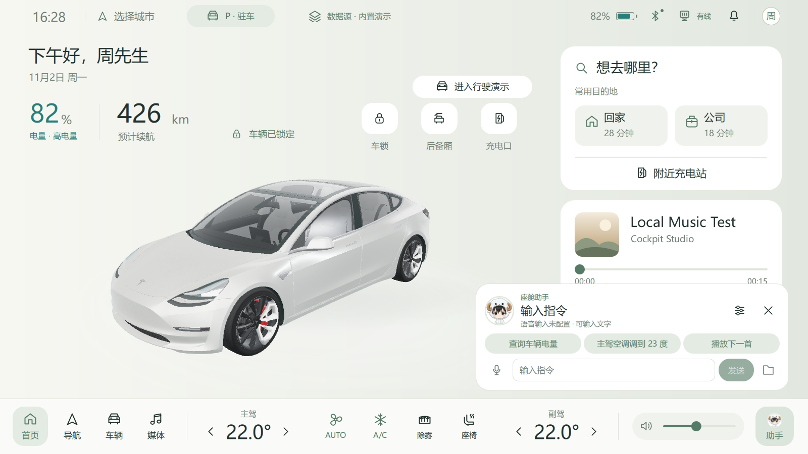

<p align="center"></p>
<h1 align="center">QML Cockpit</h1>
<p align="center"><strong>用 Qt / QML 构建的智能座舱 Demo</strong></p>

---

<p align="center">
  <a href="https://github.com/woniu101/qml-cockpit/releases/tag/v0.2.0"></a>
  
  
  <a href="LICENSE"></a>
</p>

---

<p align="center">
  <a href="#快速开始">下载</a> · <a href="#实操演示">实操演示</a> · <a href="#主要功能">主要功能</a> · <a href="#联调体验">模拟器联调</a> · <a href="#座舱助手">座舱助手</a>
</p>

## 快速开始

下载 [Windows x64 便携包](https://github.com/woniu101/qml-cockpit/releases/download/v0.2.0/QmlCockpit-v0.2.0-windows-x64.zip)，完整解压后运行 `QmlCockpit.exe`。首次可用默认的「内置演示」，从首页进入行驶演示，或从底栏打开车控、导航和媒体。按 `F11` 切换全屏。

顶栏「数据源」提供三种模式。切换前请先挂 P 挡。

| 模式 | 适合体验 |
| --- | --- |
| 内置演示 | 在单个窗口内体验车窗、驾驶和充电流程 |
| 电脑映射 | 在支持的电脑上读取实际电量和供电状态 |
| 外部模拟器 | 在两个窗口中观察车辆状态同步和指令回执 |

## 实操演示

https://github.com/user-attachments/assets/ce32dbd2-25b4-4e8e-ae83-a713da0a0295

片中展示车窗联调、导航驾驶、充电、语音调温和媒体播放。蓝牙采用拍摄模拟，语音指令通过预录音频输入。

[在哔哩哔哩观看 82 秒实操演示片](https://www.bilibili.com/video/BV1ewW46FEaL/)

## 主要功能

- **3D 车控与补能**：控制门窗、后视镜与充电口，查看实时开度和充电状态。
- **导航与驾驶**：离线示意路线，支持挡位、车速、里程和车辆状态联动。
- **座舱助手**：支持唤醒词、按键收音、语音识别、连续对话、车控指令和语音播报，可自定义参考音色。
- **媒体中心**：支持本地音乐与歌词、本地视频、网络电台及蓝牙音乐。
- **模拟器联调**：双向交换车速、电量、门窗状态和指令回执。

在媒体页导入本地音乐或视频。歌曲和同名 `.lrc` 放在同一目录即可匹配歌词。视频在驻车时观看，网络电台需要联网。使用蓝牙音乐前，先在 Windows 中完成手机配对。


## 联调体验

1. 启动[同版本整车模拟器](https://github.com/woniu101/qml-cockpit-simulator/releases/tag/v0.2.0)，保持 P 挡。
2. 在车机顶栏打开「数据源」，选择「外部模拟器」，等待显示「联调 · 已连接」。默认服务名为 `qml-cockpit.vehicle.v1`。
3. 在车机打开「车辆 → 车门车窗」，将右后窗目标设为 35%，对照两端的实际开度。也可以在模拟器操作挡位和踏板，观察车机的车速、挡位和里程变化。

如果一直显示「等待数据」，先检查模拟器是否在运行、两端服务名是否一致。两个源码仓库平级放置并完成构建后，可在车机仓库用 `scripts/run-with-simulator.ps1` 一起启动。

## 座舱助手

点击底栏「助手」打开会话。便携包可直接使用文字指令，例如「查询车辆电量」或「主驾温度调高到二十八度」。

完整语音体验需要本地唤醒、识别和合成模型，以及用于播报的参考音色。模型配置好后，可用麦克风按键收音，或在助手设置的「唤醒与对话」中启用唤醒词。默认唤醒词为「你好周同学」。同一处可开启连续对话或调整唤醒提示。

- **便携版**将完整模型目录放在可执行文件旁的 `assistant/` 下，清单路径为 `assistant/models.json`。
- **开发版**将模型清单放在 `runtime/assistant/models.json`，然后用 PowerShell 运行 `scripts/run-assistant.ps1`。

模型目录结构和准备方式见[语音助手配置](design/原生语音运行端-架构与验收.md#运行与依赖)。

<details>
<summary>查看座舱助手界面</summary>



</details>

## 从源码构建

使用 Qt 6.12、Visual Studio 2022 的 MSVC x64 工具链、CMake 和 Ninja。若安装路径与仓库预设不同，先调整 [CMake 预设](CMakePresets.json)及相关脚本。以下命令在仓库根目录的 PowerShell 中运行。

```powershell
.\scripts\setup-native-inference.ps1
.\scripts\build.cmd
.\scripts\run.cmd
```

构建产物为 `build/QmlCockpit.exe`。修改后可运行 `scripts/test.cmd` 验证基础功能，或在两个仓库均已构建后运行 `scripts/verify-link.ps1` 验证联调。

## 许可

项目源码采用 [GPL-3.0-only](LICENSE)。第三方依赖、3D 模型及演示片中的素材各自适用其许可，详见[第三方声明](THIRD_PARTY_NOTICES.md)。
