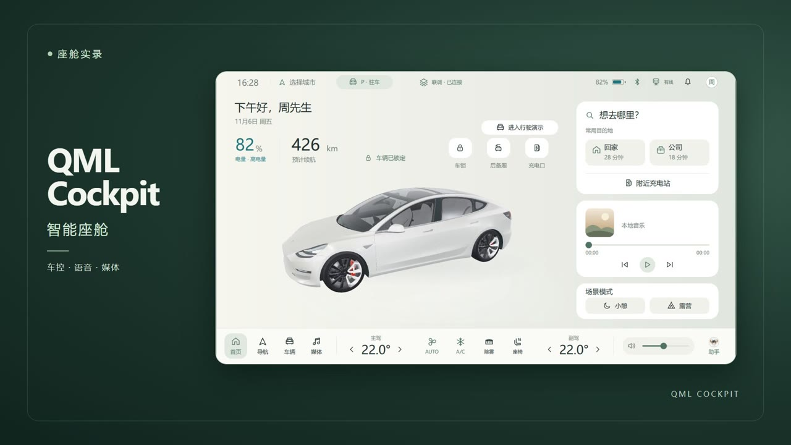
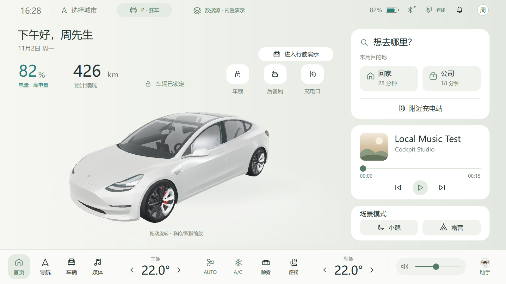
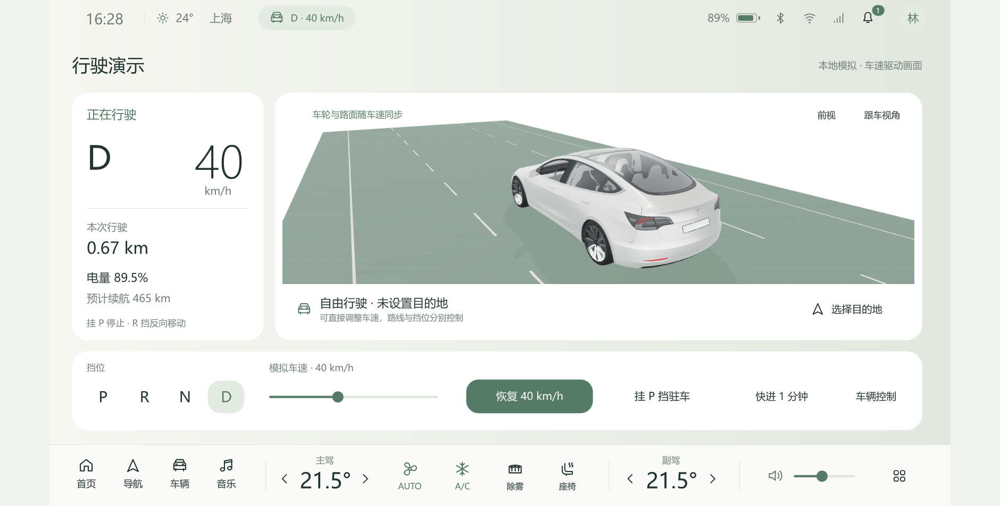

<p align="center"></p>
<h1 align="center">QML Cockpit</h1>
<p align="center"><strong>基于 Qt 6 / QML 的智能座舱实操演示</strong></p>

---

<p align="center">
  <a href="https://github.com/woniu101/qml-cockpit/releases"></a>
  
  
  <a href="https://github.com/woniu101/qml-cockpit-simulator"></a>
</p>

---

<p align="center">
  <a href="#下载与快速开始">下载</a> · <a href="#实操演示">实操演示</a> · <a href="#车辆与反馈">3D 车控</a> · <a href="#独立模拟器联调">模拟器联调</a> · <a href="#座舱助手">座舱助手</a> · <a href="#构建与验证">开发指南</a>
</p>

3D 车控、离线导航、驾驶模拟、充电补能、媒体中心和座舱助手集成在同一套交互界面中。可单独运行，也可与独立模拟器实时交换车速、电量和车窗开度等状态。

## 下载与快速开始

Windows x64 便携包的发布入口为 [GitHub Releases](https://github.com/woniu101/qml-cockpit/releases)。获取压缩包后解压，运行 `QmlCockpit.exe`，或按[构建说明](#构建与验证)从源码运行。单机演示使用内置车辆数据。联调时先启动[整车模拟器](https://github.com/woniu101/qml-cockpit-simulator)，再从车机顶栏选择「外部模拟器」。

完整的语音唤醒、识别和合成需要独立的本地模型资源。未配置模型时可使用助手的文字命令和规则处理。模型配置方式见[原生语音运行端](design/原生语音运行端-架构与验收.md)。

## 实操演示



演示展示真实车机界面、车窗联调回执、驾驶、补能、语音调温和媒体播放。蓝牙连接采用拍摄模拟，语音指令通过预录音频输入。

开发程序为 `build/QmlCockpit.exe`，窗口标题为“QML Cockpit · 智能座舱”。浅灰绿图标采用全景座舱轮廓，多尺寸 Windows 图标可用 `scripts/create-app-icon.ps1` 重新生成。

Qt 6 / QML Windows 演示，延续已确认的浅色、鼠尾草绿设计。车辆、音乐和视频可离线使用，网络电台需要联网。逻辑画布 1600 × 900，最小窗口 1120 × 630；其他宽高比居中留白。





## 启动与入口

- 开发阶段执行 `scripts/build.cmd` 构建，再运行 `scripts/run.cmd`。脚本设置 Qt 运行路径，构建只生成开发产物。
- 点击顶栏天气选择城市。城市保存在本机，天气由 Open-Meteo 每 15 分钟更新，查询失败时标注上次读数或显示暂无数据。
- F11 切换全屏；Esc 关闭浮层、退出自动演示或退出全屏。
- 右上圆形头像“周”打开显示与偏好设置，包含主题、3D 画质、自动定位、自动演示及恢复初始状态。
- 顶部 `P · 驻车` / 挡位车速：驾驶演示，可选 P/R/N/D、调整车速、快进行驶。
- 首页“进入行驶演示”：自动收起弹窗并进入独立行驶页面。无路线也可自由行驶；大号挡位/车速、道路滚动、真实轮胎/轮毂旋转、本次里程和 SOC 联动。挂 P 停止；R 挡反向移动且最高 15 km/h。
- “车辆 → 车门车窗 → 车窗”：四窗位置、当前百分比、目标数字输入、滑条、0/15/50/100% 预设及执行中的停止按钮。
- “车辆 → 快捷控制”：门锁、前后备厢、后视镜、充电口、全部关窗和全车通风。
- 顶部“数据源”：选择内置演示、电脑映射或外部模拟器。切换前先挂 P 挡；来源不写入偏好，也可用 `scripts/run.cmd --source=internal|system|external` 指定启动来源。
- 顶部网络入口：显示 Windows 当前有线、Wi-Fi、离线或未知状态，点击查看电脑电源与网络详情；网络状态独立于车辆数据来源。
- 顶部电池入口：小闪电表示正在充电，插头表示接电未充电，刷新标记表示状态待更新；点击进入补能详情，不改变挡位或充电状态。
- 顶部蓝牙入口：读取 Windows 适配器开关与已配对设备状态；可选择支持的已配对手机，连接/取消/断开蓝牙音乐接收。
- 媒体页“音频输出”与底栏扬声器入口：选择应用内音乐、电台、视频的输出或跟随系统默认设备；音量不控制手机接收声音。所选输出移除时回退默认设备，没有输出时暂停，恢复设备后不自动播放。

仓库包含源码、基础界面素材及模型署名。用户导入的媒体、音色与本地模型缓存单独保存在本机。

## 车辆与反馈

百分比表示开度：0% 全关，100% 全开，支持 1% 步进。拖动时直接预览；数字输入和预设采用统一速度的平滑升降。数值、四窗卡片、3D 和当前通知共用 C++ 的模拟实时开度；停止后不会回到旧目标。

单窗操作在控制区就地反馈；全车操作、受限操作、媒体错误显示在状态栏下方的保留区域。警告优先，重复消息合并。通知角标表示当前提醒数，状态解除后消除，点击可定位对应部件。

3D 使用 Ameer Studio 的 Tesla 2018 Model 3，支持旋转、滚轮/双指缩放、车内视角、命名视角和自动定位开关。四门、四窗、前后备厢、后视镜有独立动画；充电口、插枪和线缆用新增的简化几何演示。枪体包含金属接口、外壳、握柄和充电状态灯，线缆使用连续曲面自然落地；补能页提供充电动效、目标刻度与达标状态。玻璃完全降下后仍在窗框保留选中标记。加载失败显示静态预览并提供重新加载。

首页模型在原构图基础上右移 40、上移 45 个设计像素，大小和初始角度保持不变。操作提示在每次启动后首次进入首页时显示，4.5 秒后或开始旋转/缩放时消失；切换页面后不再重复，车辆控制页继续保留操作说明。

车门、前后备厢及充电口只允许 P 挡操作。开启车门自动解锁；关门动画未结束时不能锁车；开着车门/备厢/充电口或连接着充电枪时不能开始行驶。挂 D/R 挡自动锁车并展开后视镜。内置模式由本地状态模型执行；外部模式由独立模拟器校验、执行并返回回执，仍属于虚拟车辆演示。

首页与补能页车外视角在充电时显示线缆光点、车底呼吸光晕和十段电量示意；其他车辆分类保留实际插枪、线缆和接口灯，车内隐藏外部充电装饰。所有模型页面均移除浮动电量卡。首页在电量区下方用透明摘要显示状态、功率、预计时间和“查看补能”；补能页的电量、状态和控制集中在右侧，模型标记仅说明充电口位置。暂停、完成和过期停止能量流动。

状态区分正在充电、已连接未充电、目标完成、100% 满电及数据过期。SOC 分为极低、低、常规、高和满电，配合红/琥珀/绿/青绿；各页颜色一致。顶栏与首页整数 SOC 向下取整，详情保留一位小数，低于 100% 时不提前显示满电。Windows 原始整数精度保持不变，过期读数使用次级色。具体区间见 [充电状态与电量分区显示](design/充电状态与电量分区显示.md)，全局规则见 [模型叠层优化方案](design/全局能量信息与模型叠层优化方案.md)。

## 独立模拟器联调

另一个仓库 [qml-cockpit-simulator](https://github.com/woniu101/qml-cockpit-simulator) 是独立的 Qt Widgets / C++ 程序。分别构建两个仓库后，推荐平级目录结构：

```text
D:\Projects\car_terminal\
  qml-cockpit\
  qml-cockpit-simulator\
```

在本仓库执行：

```powershell
.\scripts\run-with-simulator.ps1
```

将打开模拟器控制台和外部模式车机。也可分别执行两边的 `scripts/run.cmd`，再从车机顶部“数据源”选择“外部模拟器”。默认本机服务名 `qml-cockpit.vehicle.v1`；车机也支持 `scripts/run.cmd --external --vehicle-server=服务名`。

控制台可修改 SOC、四窗实际开度、车门、P/R/N/D 和速度，演示充电并注入拒绝、丢弃请求、延迟、遥测过期和断连。车机发目标后等待外部实际状态，窗位连续反馈驱动 3D；数据过期时保留最后状态并暂停外部控制和道路/车轮动画，恢复后自动重连。切回内置演示恢复切换前的车辆状态，并保留当前本地音乐、空调和显示设置。

外部模式接管能量、行驶和车身，音乐、空调及灯光仍保留本地控制。Windows 电源和网络由车机独立读取，不改变模拟器协议。协议说明见 [vehicle-protocol-v1.md](docs/vehicle-protocol-v1.md)。两个仓库独立构建；平级路径只用于便捷启动与联调测试。

## 电脑映射

选择“电脑映射”后，电脑电池百分比直接作为车辆 SOC，电池供电、外接电源未充电、系统正在充电和满电分别展示。顶部、首页、补能页和模型使用同一份电量与状态；充电光点、光晕与分段电量跟随实际状态。系统电量以整数显示，续航仍按车辆模型估算。

真实电池模式只读取 Windows 状态，隐藏模拟插枪、充电目标、开始/暂停和快进按钮；充电功率与预计时间显示“未提供”。模拟行驶只推进里程和导航，不扣减电脑 SOC；虚拟目标 90% 也不会停止电脑的实际充电。外接电源时暂停行驶演示，保留挡位并提示挂 P。

系统明确报告没有电池时，标注“无系统电池 · 模拟电量”，继续提供模拟行驶和补能。台式机接通交流电不会被当成车辆插枪。读取失败或信息不完整时保留最后确认值并标注等待；首次读取未知显示“—”，暂停能量动效与行驶，等待恢复。电池移除后使用模拟电量并暂停行驶。

网络使用 Windows/Qt 报告的联网范围与连接类型；同时存在多个无法判定主路径的接口时显示“多网”。详情列出活动接口、网络认证和流量计费状态。当前没有 Wi-Fi RSSI 数值，图标表示连接类型。蓝牙状态原生采集，手机音乐可通过 Windows 的 A2DP Sink 接收。

实现边界、硬件实测与测试样本说明见 [Windows 电量与网络接入验收](design/Windows电量与网络接入-验收.md)。

## 蓝牙与本地音乐输出

蓝牙面板区分无适配器、已开启、已关闭、系统禁用、状态未知、访问受限和读取失败。列出系统已配对的经典/低功耗蓝牙设备，分别展示配对与设备连接状态；连接了键盘或鼠标不会显示为手机音乐已接通。采集在后台执行，设备变化、恢复和手动刷新时更新，另以 10 秒轮询校准。应用不自动开启蓝牙、扫描未配对设备或发起配对。

本地播放器支持输出设备选择及“跟随系统默认”。显式输出不随系统默认切换；该设备移除后改为跟随默认，设备重新出现也不会自动切回。输出选择保存在本机偏好中，不改变 Windows 默认输出和主音量。无输出时播放入口禁用，播放请求也会被拦截；设备恢复后等待用户操作。

手机音乐采用 Windows `AudioPlaybackConnection`：先在系统配对手机，再从顶栏蓝牙入口或音乐页“手机蓝牙音乐”选择“连接音乐”。“设备已连接”与“手机音频已接通”分别显示，后者代表音频通道建立，不能据此判断手机是否正在播放。播放、暂停、切歌和音量目前在手机操作，不显示虚构的曲名、封面或进度。

接收声音由 Windows 输出到系统默认设备；本地输出选择与底栏本地音量不控制手机声音。连接期间暂停本地播放器、隐藏本地播放控制，底栏提示“手机调音量”；取消、失败、断开和设备恢复都不自动播放本地音乐。支持连接超时、取消、远端断连、移除设备及退出清理，不自动重连。需要 Windows 10 2004+ 及兼容的蓝牙适配器/驱动。

本阶段不包含通话或远端媒体控制。状态与本地输出验收见 [蓝牙状态与本地音频输出](design/蓝牙状态与本地音频输出-验收.md)，接收模块及实机记录见 [手机蓝牙音乐接收](design/手机蓝牙音乐接收-验收.md)。

当前保留原有蓝牙连接界面：可连接、断开手机音频，播放与音量由手机控制；不显示尚未取得的歌名、进度或封面。Windows 媒体会话及 AVRCP 桥接验证未取得本机 vivo 的真实曲目信息，已撤回实验性信息来源适配。未改动驱动、配对或系统服务。证据与后续边界见 [AVRCP 核验与回退记录](design/蓝牙曲目信息-原生适配与AVRCP评估.md)。

## 本地音乐库与歌词

底栏“媒体”进入“音乐 / 电台 / 视频 / 手机蓝牙”。音乐视图显示封面、歌曲信息、歌词、播放控制和音乐库；手机视图展示接收连接与默认输出说明。切换到音乐会断开手机音乐接收，等待手动播放。

音乐可放在任意可访问的本地目录，通过“添加音乐目录”递归扫描子目录，或“导入文件”多选添加，也可拖入文件/目录。后台扫描可停止，不跟随目录符号链接；单次上限 50,000 个音乐文件。重复导入按规范化路径去重，原文件不复制到仓库。扩展名筛选为 WAV、MP3、FLAC、M4A、OGG、AAC、Opus、WMA，实际可播放性由 Qt 解码后端与文件内容决定，不处理平台加密文件。

支持全部歌曲、收藏、歌手、专辑、文件夹筛选与搜索，按歌名、歌手或加入顺序排序。选父目录可包含其下子目录。收藏、导入条目、音乐目录、歌词偏移和最后曲目/位置保存到当前用户的本地应用数据目录（`music/library.json`），封面缓存位于相邻 `covers`。重启恢复曲目及位置，保持暂停。移除条目只影响索引，不删除文件；重新扫描不会自动加回已移除的条目，手动导入该文件可重新加入。文件失效会标记，并支持重新定位。

点击库中的歌曲时，以当时的分类、搜索和排序结果建立播放队列；随后浏览其他分类不会改变队列。音乐页“播放队列”可查看范围、调整顺序和移除待播歌曲；当前曲目保留，移出队列不删除音乐库条目。顺序切歌和随机播放均限定在队列内，跳过缺失文件；随机一轮尽量不重复，上一首回到实际播放历史，再下一首沿历史前进。历史保留本次运行最近 500 次切换，重启恢复队列顺序并保持暂停。

“目录管理”列出扫描根目录、可访问状态和曲目数量，可添加、重新扫描或移除。移除目录会清理仅由该目录管理的索引，保留其他根目录共享和单独导入的歌曲，原文件保留。自动监测新增、缺失、恢复及歌词变动，通知合并 500 毫秒、定时检查间隔 5 秒；Windows 避免对子目录层层持有监听句柄，深层变化由后台检查覆盖。音源断开时暂停，重新可用后等待手动播放；重新定位歌曲会同步替换队列中的路径。详情见 [播放队列与目录监听验收](design/播放队列与目录监听-验收.md)。

扫描时读取系统支持的歌曲标签，播放时补充 Qt 的歌名、歌手、专辑和内嵌封面。缺少标签回退文件名/未知歌手；封面缺失时查找同名 JPG/PNG、目录 `cover.jpg/png`、`folder.jpg/png`，最后使用默认图。不同格式可提供的字段取决于文件标签及后端。

兼容部分扩展名为 `.mp3`、实际为“前置 ID3 标签 + M4A/MP4”的本地音源：验证容器后通过可寻址的只读视图播放内部数据，保留原文件路径、队列和同名歌词关联，并提取外层歌名、歌手、专辑和封面。不会改名、转码或改写源文件。实际音乐文件可用 `build/MusicMediaProbe.exe 音乐目录 报告.json` 静音检查递归解码、播放进度、跳转后续播及歌词解析；报告只保存检查结果。

同目录同名 `.lrc` 自动加载，也可用同名 `.txt` 显示静态文本。支持 UTF-8、带 BOM 的 UTF-16，以及 Windows 下的 GB18030/GBK 中文；时间戳、多时间戳、同时间双语合并和 `[offset:]`，当前句高亮、自动跟随、点击歌词跳转、手动滚动后回到当前，以及每曲 ±10 秒偏移。正的界面偏移表示歌词延后；跳转不自动开始播放。修改歌词后点“刷新歌词”。例如：

```text
D:\Media\Music\歌手\专辑\歌曲.mp3
D:\Media\Music\歌手\专辑\歌曲.lrc
D:\Media\Music\歌手\专辑\cover.jpg
```

蓝牙歌名、进度、封面、歌词与车机端切歌仍未接入。接收接口本身没有这些字段；本机已连接 vivo 时的系统媒体会话只读探测返回空集合，不将其他桌面播放器会话当作手机信息。`MediaSessionProbe.exe` 可复查，结果写入忽略提交的 `artifacts/music/phone-sessions.json`。具体实现和验收见 [音乐库与歌词](design/音乐库与歌词-验收.md)。

## 网络电台与本地视频

电台首批提供中国之声、经济之声、音乐之声与香港电台第一台。通过广播机构公开播放器配置解析实时地址，支持搜索、收藏、最近收听与上一/下一收藏台。界面明确标注“网络直播”，不模拟不存在的射频信号、频率或歌曲信息。连接、缓冲和重连均可停止；最多自动重试三次，停止、切台或切换来源后取消旧请求。台源会变化，短时可播不代表长期可用。

视频通过“导入视频”“添加视频目录”或拖入文件/目录添加，递归扫描子目录。建议目录 `D:\Projects\car_terminal\media\video`，也可使用其他本地目录。支持缩略图、搜索、按文件夹浏览、最近观看、断点续播、倍速、前后跳转 10 秒、音量、可收起列表与全屏；保持原画面比例，Esc 退出全屏。缺失文件可重新定位，移除条目/目录只修改索引。

视频只在 P 挡、零车速且车辆数据有效时允许播放。挂入其他挡位、数据过期或离开视频页后暂停并保存位置；重新驻车后等待手动继续。静音视频标注“无音轨”，无需音频输出也能播放；有音轨视频在无输出时暂停。内嵌音轨/字幕提供 Qt 暴露的选择入口，外置 SRT 尚未实现。可导入 MP4/MKV/WebM 等后缀，实际解码能力取决于编码与 Qt 后端，已验证 H.264/AAC MP4、无音轨 H.264 MP4 和原始 AVI 样本。

音乐、电台和视频共享一个前台播放器，手机接收由 Windows 独立承载并与其互斥。首页、导航及行驶页使用统一媒体卡。音乐与电台可以后台收听；首页的视频卡仅提供返回入口。媒体状态已从 VehicleState 移出，不保留旧媒体转发接口。实现边界、模块与测试记录见 [媒体中心开发与验收](design/媒体中心-开发与验收.md)。AI/语音助手仍按第二阶段推进。

## 座舱助手

开发版通过 `scripts/run-assistant.ps1` 启动，默认使用 `build/QmlCockpit.exe`，模型由 `runtime/assistant/models.json` 管理。唤醒、ASR、NLU 和 ZipVoice 均在 C++ 后台线程运行，不再启动 Python；训练与导出工具继续使用 Python。首次构建先运行 `scripts/setup-native-inference.ps1` 准备固定版本原生 SDK。架构、资源导出与更新方法见[原生语音运行端](design/原生语音运行端-架构与验收.md)。「助手」会话始终在底栏右侧入口上方展开。车速为零且车辆数据有效时，支持文字输入、点选和通过文件夹按钮导入 0.2 至 10 秒的本地 WAV/MP3 指令音频，统一解码为单声道 PCM16。行驶中或联调数据不可用时显示简洁语音卡。P 挡可通过会话右上角齿轮打开设置，返回键回到原入口。麦克风可用时按麦克风图标开始，点停止图标结束录音，最长 8 秒。

先把所需歌曲或视频导入现有媒体库。可以说「播放周杰伦的一路向北」「播放七里香MV视频」「上一首」「下一首」「暂停音乐」「继续播放」「音量调到30%」或「快进十秒」。点播按库内标题和歌手匹配，歌曲与同名 MV 等有多个结果时列出选项。视频沿用驻车条件。播放器确认点播开始后，助手显示结果并切到对应媒体页。成功播放音乐/视频，以及切歌、暂停、继续、音量和进度调整默认不追加语音确认，避免歌曲先响、再被播报打断；失败仍按回复偏好提示。

可以查询「现在还有多少电」「主驾空调多少度」或「左前车窗开了多少」。rbtl3-v8-classifier FP32 处理符合准入条件的电量和车窗开度查询。查询须与原句主题和窗位相符，结果读取当前车辆状态。空调查询和改变状态的命令由规则处理。「设置 → 座舱助手 → 开发调试」显示对照结果，支持回放、记录样本和人工纠错。样本保存在项目的 `artifacts/assistant/samples.jsonl`，可导入研究目录训练。

当前清单选择扩充训练后的 rbtl3-v8-classifier FP32；单窗确认试点继续使用已验收的 rbtl3-v7 INT8。NLU 的文件名和精度由模型目录的 `inference.json` 指定，运行端不把 FP32 文件伪装为 INT8。导出工具核对单窗验收记录和模型指纹，运行端再校验完整模型包 SHA-256。没有配置模型时提供既有明确命令的规则处理，并提示模型不可用。例如输入「请将右后车窗的开度设为 35%」，助手会核对原句中的窗位和开度，再请用户确认。确认后发送车控指令，联调时以模拟器回报的实际开度为准。快捷车控及其它写入仍使用已有规则。开发调试面板可查看提案、确认状态和执行结果。训练结果及限制见 [本轮 NLU 更新](design/NLU-v8-训练与部署.md)。

纠错可记录正确语义类别、意图和参数 JSON。ASR 转写有误时可填写原句。要导入下一轮训练，带实体的样本可填写标注文本，例如「把[TARGET:右后]窗开到[VALUE:30%]」。研究目录的 `training/build_data_v4.py --review-log <JSONL> --output <数据集名>` 会校验标注与参数并保留既有验证集。

「空调调到 24 度」会追问主驾或副驾。「把车窗开到 30%」会追问窗位。可点击候选、输入或说出位置。取消、关闭会话、超时或提交另一条指令都会清除等待补全的参数。车窗仍以模拟器回执和实际开度确认结果。

车窗或温度操作确认后，可在同一会话的 25 秒内继续说「再开一点」「再关 5%」或「再低一度」。助手用最近确认的对象和当前读数计算，车窗的「一点」是 10 个百分点，温度的「一点」是 0.5 度。没有可用对象时会追问。等待上一条车窗回执时可稍后重说，关闭会话、取消、切换任务或联调断开会清除上次对象。

对话会分别处理缺位置、越界数值和改口。车窗动作完成后说「不对，刚才那扇换成左前」，助手会说明原车窗开度并等待确认，新车窗在确认后才会调整。发现多个车控动作时会询问先处理哪一项。「我问的是开到多少」会追问要查询的车窗。「现在剩余多少点」会确认是否查询车辆电量。语音转写中的「五当」和「三十五百分号」分别只在明确的风量和车窗开度指令中解析。

语音回复使用本地 sherpa-onnx ZipVoice-Distill INT8。「设置 → 座舱助手 → 声音」提供「获取声音 → 核对原文 → 试听并启用」音色向导。可导入不超过 120 秒、32 MB 的 WAV/MP3，从中选择 1–15 秒的单人参考片段，也可倒计时后朗读提示文本录制。导入和录制会自动转写参考原文，允许核对、修改或口述。参考原文与试听文案独立，试听成功后才能保存启用；离开未保存时可保留或放弃草稿。录音、裁切和转写的临时草稿仅在当前进程保留。

声音设置包含收音/播报设备、独立播报音量和三档语速。语速使用播放器音高补偿。「语音＋文字」对文字和语音请求的最终回复均播报，「仅语音输入时播报」只播报语音请求，「仅文字」保持安静；会话可重播回复，输出和合成失败会提示原因。自定义试听句可输入或口述。设置页中的转写与口述仅填写表单，不提交车辆指令。

「形象」支持 PNG/JPG，通过拖动平移、滚轮或双指缩放调整构图，并查看底栏入口与会话头像的实际尺寸及六种状态预览。保存后持久使用，取消恢复当前形象，也可隐藏、减少动效或恢复默认羊角帽。头像与音色分别保存。设置弹层阻止背景 3D 模型接收滚轮，设置期间暂停唤醒监听。

「设置 → 座舱助手 → 唤醒与对话」可开启本地唤醒，默认关闭。预设词为「你好周同学」，可保存模型支持的 4–8 字中文短语。启用后说出唤醒词，看到「正在听」再说指令。打开「连续对话」后，按键或唤醒开始的会话在停顿时自动提交，在回复结束后收听下一句。静音超时、说「结束对话」或关闭卡片会结束本轮连续收音。「用唤醒词打断播报」需要启用唤醒，命中后停止当前播报并开始收音。设置页可回放 PCM16 WAV 测试唤醒词，试测只显示命中状态。

「唤醒提示」默认是一声短提示音，也可选择用当前音色说「我在」或静音。选择「我在」后，程序会提前准备音频，准备期间使用短提示音。提示播完后开始收音；点底栏头像只打开会话，点麦克风直接收音，连续对话的后续收音保持安静。

「声音」可分别选择助手的收音和播报设备，默认随 Windows。唤醒与按键录音共用所选收音设备。明确选中的设备拔掉后保留选择，重新连接后恢复。默认羊角帽形象随待机、聆听和播报切换轻量表情，自定义头像仍支持状态光圈及减少动效。

可用「然后」连接两到三项明确的单窗开度和主副驾温度命令，例如「先把右后窗开到 42%，然后把主驾温度调到 23 度」。助手先复述计划并等待确认，执行后逐项显示实际结果。失败或取消后续时保留已完成项，其余标为未执行。空调温度仍由车机本地状态确认。

车控支持「关闭全部车窗」「右后窗开到百分之三十」「副驾驶温度调到二十三度」「风量调到三挡」和「关闭空调制冷」。外部模拟器模式下，车窗需要本次指令的完成回执和目标车窗的实际开度确认。等待及执行进度显示在面板，得到最终结果后按回复偏好播报。空调沿用车机本地设定及主副驾同步开关。电台支持「收听中国之声」及「收听收藏电台中国之声」，连接并开始播放后确认。

## 主要交互流程

- **导航与行驶分别控制**：驻车时可规划路线；开始导航不改变挡位或车速；驻车不结束导航，结束导航不改变行驶状态。回家、公司、公园、充电站使用不同的示意路线数据，首页距离/时间、地图、车标、转向和 ETA 统一计算。到达只结束导航，停车需单独操作。行驶页显示当前目的地、剩余距离/时间并可切换地图；不自动创建路线。首次开始为 D 挡 40 km/h，已在 D 挡行驶时进入页面保留当前车速。
- **模拟充电**：P 挡打开充电口 → 连接充电枪 → 设置目标电量 → 开始充电。可暂停、快进 5 分钟、断枪和关闭充电口。SOC、续航、55 kW 功率和预计时间联动，到达目标自动停止。电脑真实电池模式跟随系统状态。
- **空调与座椅**：双区温度、SYNC、风量、AUTO、A/C、吹风方向、除雾和 0–3 挡座椅加热；退出除雾恢复之前的风量/AUTO/A/C；小憩、露营退出后恢复进入前的空调设置。
- **灯光**：关闭、自动、开启及远光/雾灯分组，与模型灯光材质联动。
- **音乐**：通过本地曲库播放、暂停、切歌、调整进度和音量，支持循环与随机、目录递归导入、标签与封面、收藏搜索、LRC 歌词与断点记忆。首次使用时导入自己的音乐。手机蓝牙音乐有独立来源视图。
- **偏好**：温度、风量、音量、主题、SYNC、风向、加热档位、灯光模式、画质、自动定位、充电目标及循环模式自动保存；每次启动门窗、挡位、SOC 等运行状态回演示初值。自动主题 18:00–06:00 使用夜间外观。
- **自动演示**：12 步，支持暂停、继续、单步和 0.5/1/2 倍速；手动操作会暂停。退出后恢复进入前的车辆状态和偏好，演示过程不写入偏好文件。

## 数据与素材范围

地图、路线和车身信号为本地示意数据；内置和模拟器模式的电量随模拟行驶/充电变化，电脑模式使用系统电池或明确标注的无电池回退。Windows 网络、蓝牙设备及手机蓝牙音乐接收使用真实系统接口。尚未接入真实地图、联网音乐平台、网络设备配置、CAN、手机投屏或语音服务。没有座椅位置/通风及通知历史功能，这两项在方案中属于后续扩展。

真实车型与早期无品牌静态稿存在外观差异。当前模型、修改说明与 CC BY 4.0 署名见 `THIRD_PARTY_NOTICES.md`、`assets/sedan/source/`。原始 GLB 保留，后视镜从车门几何分离为可动部件；充电口是简化演示部件，不是原车型精确机构模型。

保留的旧双门概念车通过 `QmlCockpit.exe --legacy-3d` 运行，仅作技术参考。

## 构建与验证

环境：Visual Studio 2022 Community、MSVC x64、Qt 6.12.0、CMake、Ninja。现有脚本使用开发机器的 `D:\Microsoft Visual Studio` 与 `D:\Qt`。在其他电脑上构建时，请按安装位置调整 `CMakePresets.json` 和 `scripts/` 中的工具路径；也可在 VS 中打开 CMake 工程，使用 `windows-msvc-release` 预设。

```powershell
.\scripts\build.cmd
.\scripts\test.cmd
.\scripts\verify-native.ps1
# 已构建独立模拟器时：
.\scripts\verify-link.ps1
.\scripts\verify-link.ps1 -Scale 1.25
# 电脑映射、只读补能和网络展示：
.\scripts\verify-system.ps1
.\scripts\verify-system.ps1 -Scale 1.25
.\scripts\verify-devices.ps1
.\scripts\verify-devices.ps1 -Scale 1.25
.\scripts\verify-music.ps1
.\scripts\verify-music.ps1 -Scale 1.25
# 正式媒体页、电台解析/解码和视频交互：
.\scripts\verify-media.ps1
.\scripts\verify-media.ps1 -Scale 1.25
# 独立台源与视频样本工具：
.\scripts\build-media-tools.cmd
.\scripts\verify-radio.ps1
# 手机媒体会话只读能力探测（独立控制台程序）：
.\build\MediaSessionProbe.exe
# 蓝牙和音频输出只读采样，不显示窗口：
.\scripts\run.cmd --device-probe
# 无桌面窗口的组件绑定检查（不替代界面验收）：
.\scripts\run.cmd --device-qml-check
# 本机只读采样，写入 artifacts/system/live.json：
.\scripts\run.cmd --source=system --system-probe
```

需要发布时，可另行执行 `scripts/package.cmd` 和 `scripts/verify-release.ps1`；日常调试无需打包。

状态测试覆盖实时开度、停止/取消、批量关闭、驻车与导航独立性、行驶互锁、充电目标、空调恢复、通知、媒体语义和偏好隔离。`--smoke-test` 使用 basic 渲染循环；`--smoke-native` 使用默认渲染循环，验证实际鼠标/键盘、合成双指触控、精确 35%、停止、网格画面变化、导航/充电/音乐、演示恢复和缩放。默认渲染测试还反复执行 3 次完整演示并采样两档画质的帧率与进程内存。

测试输出在 `artifacts/v6/`。`CAR_TERMINAL_SMOKE_DIR` 可指定输出目录；`QT_SCALE_FACTOR=1.25` 用于高 DPI 测试；`CAR_TERMINAL_SKIP_SOAK=1` 可跳过重复演示。测试使用 `CAR_TERMINAL_NO_SETTINGS=1` 隔离用户偏好。

双进程测试输出在 `artifacts/link/`，会启动独立名称的真实模拟器进程，验证四窗目标/实际/停止、3D 玻璃、SOC/速度、充电达标、拒绝、超时、失联冻结、导航补算、重连、模拟器重启和本地状态恢复。可通过 `verify-link.ps1 -SimulatorExe 完整路径` 指定模拟器。状态测试另覆盖协议版本、分帧、会话隔离、快照顺序与非法数据。

系统状态测试覆盖未知标志、无电池回退、只读 SOC/充电、故障保留、源切换恢复和网络类型；界面测试使用可控样本，不代表当前电脑硬件，输出在 `artifacts/system/native/` 与 `dpi125/`。本机采样另存 `artifacts/system/live.json`，与测试样本分开。

设备测试输出在 `artifacts/devices/`。`DeviceServicesTests` 检查默认/显式输出、移除回退和实际设备的静音播放；`verify-devices.ps1` 验证蓝牙状态样本、输出选择与最小窗口。`live.json` 为本机采样，界面截图和 `verification.json` 分别标注实际路由与模拟插拔拓扑；物理蓝牙设备仍需对应硬件验收。

音乐测试输出在 `artifacts/music/`。`MusicLibraryTests` 覆盖索引持久化、歌词、标签、封面、队列范围/顺序、随机历史、共享目录移除、目录移动恢复和重新定位；`verify-music.ps1` 使用原创静音音源验证实际解码、目录/收藏/搜索、歌词与进度、队列编辑和目录管理，以及独立启动进程恢复 6 秒位置并保持暂停。隔离测试可用 `CAR_TERMINAL_MUSIC_LIBRARY_FILE` 指定索引文件；不设置时使用当前用户本地应用数据目录。

模型重新生成：`python scripts/prepare_sedan.py`。脚本分离后视镜、经 Balsam 转换，并保留材质修正、纹理处理和部件绑定。源文件与 SHA-256 见 `assets/sedan/source/download.json`。

## 文件组织

- `qml/`：页面、控制面板、反馈、3D 场景和演示脚本。
- `src/VehicleState.*`、`VehicleMotion.cpp`、`VehicleSimulation.cpp`、`VehiclePreferences.cpp`：共享状态、运动进度、路线/补能及偏好。
- `src/VehicleExternal.cpp`、`VehicleLink.*`、`src/protocol/`：外部车辆数据适配、进程通信及协议校验。
- `src/SystemStatus.*`、`src/VehicleSystem.cpp`：Windows 电源/网络采集、电脑电量映射和无电池回退。
- `src/SystemSmoke.cpp`、`tests/VehicleSystemTests.cpp`：系统映射界面与状态回归。
- `src/BluetoothStatus.*`、`src/BluetoothAudio.*`、`src/AudioDevices.*`：蓝牙后台状态、手机音乐接收和本地音乐输出管理；`BluetoothAudioTests`、`DeviceServicesTests`、`DeviceSmoke` 验证接收生命周期、路由及界面。
- `src/LinkSmoke.cpp`：真实双进程 UI 联调回归。
- `src/media/`：媒体状态/音乐队列、共享目录遍历、播放器会话、广播目录与来源解析、视频索引/缩略图及观看记录；`VehicleState` 不再持有媒体状态。
- `src/MusicLibrary.*`、`MusicLibraryScan.cpp`、`MusicFiles.*`、`Lyrics.*`：本地音乐索引、目录监听、文件属性与封面、歌词解析；`MusicSmoke`、`MusicLibraryTests` 验证实际播放与持久状态。
- `qml/MediaPage.qml`、`MusicPane.qml`、`RadioPage.qml`、`VideoPage.qml`、`PhoneMusicPane.qml`、`MediaCard.qml`：媒体容器、独立子页和共享媒体卡；`AppRoutes.qml` 定义页面标识。
- `src/UiSmoke.cpp`、`tests/`：实际界面与状态测试。
- `assets/sedan/`：模型、网格、纹理、来源与署名。
- `design/v1/`：原静态稿；`design/v2/`：交互规格和状态稿。
- `design/车机演示交互优化方案-v2.md`：本轮实施依据。
- `design/v2/实施与验收记录.md`：交付范围、验证结果与性能数据。
- `design/v2/顶部信息栏与行驶演示-v6.md`：本轮布局、行驶画面和验收记录。
- `research/`：前期国内新能源车机调研。

调研报告与原始网址记录保留在仓库中；调研时下载的网页、品牌截图和参考项目副本属于本地缓存，不纳入源码提交。重新生成研究报告需要自行准备相应图片，不影响应用构建。

## 素材署名

第三方模型及依赖说明见 [THIRD_PARTY_NOTICES.md](THIRD_PARTY_NOTICES.md)。模型的 CC BY 4.0 署名、完整许可文本与来源记录随项目保存，各素材按各自许可使用。
