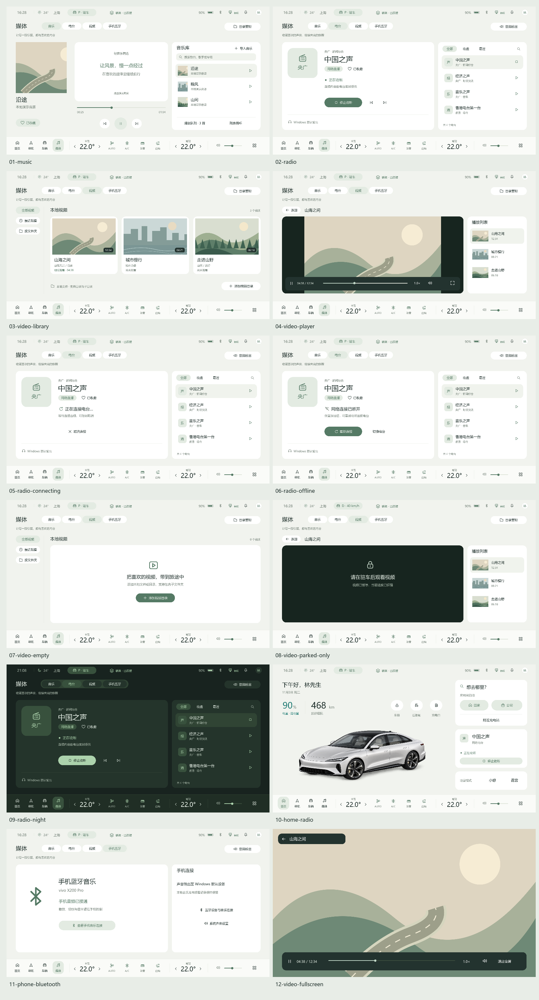

# 媒体中心设计与台源验证 · 阶段 1A

日期：2026-11-03。本文记录阶段 1A 的静态稿和独立台源能力原型。后续电台与视频已接入正式车机，实际实现和验收范围见 [媒体中心开发与验收](../媒体中心-开发与验收.md)。下方画板仍为静态设计，不是运行截图。AI 仍为第二阶段。

## 查看设计

打开 [本地评审页面](index.html)，可切换 12 张画板并选择适应窗口、1600 × 900、1120 × 630 或 125% 导出尺寸。页面内按钮为静态示意，左侧画板选择和尺寸切换可用。



| 画板 | 内容 |
|---|---|
| [01 音乐](screens/01-music.png) | 现有音乐库的媒体中心布局，歌词/无歌词区域、队列和播放控制 |
| [02 电台](screens/02-radio.png) | 当前电台、网络直播、收藏、频道列表、停止与前后台切换位置 |
| [03 视频库](screens/03-video-library.png) | 三列视频海报、文件夹、最近观看和继续观看 |
| [04 视频播放](screens/04-video-player.png) | 保持 16:9 内容比例，侧边列表、进度、倍速和全屏入口 |
| [05 连接中](screens/05-radio-connecting.png) | 等待连接和可取消操作 |
| [06 网络断线](screens/06-radio-offline.png) | 状态原因、重新连接及切台入口 |
| [07 视频空库](screens/07-video-empty.png) | 初次添加文件夹的明确入口 |
| [08 驻车限制](screens/08-video-parked-only.png) | 行驶时暂停与进度保留提示 |
| [09 夜间](screens/09-radio-night.png) | 使用现有主题色验证电台页面层次 |
| [10 首页媒体卡](screens/10-home-radio.png) | 电台取代当前音乐卡，同一区域不堆叠多张媒体卡 |
| [11 手机蓝牙](screens/11-phone-bluetooth.png) | 保持已验证的音频连接说明，不添加未取得的歌曲信息 |
| [12 全屏视频](screens/12-video-fullscreen.png) | 隐藏底栏后的播放与退出全屏操作 |

每张画板同时提供可编辑 SVG、标准 PNG、`@min.png` 和 `@125.png`。这是静态缩放与视觉检查，不等于正式 QML 在不同 DPI 下的运行验收。

画面文字、进度、收藏、网络状态和视频条目为设计样本，不是正在运行的真实状态。台标是自绘文字占位，非官方品牌素材；视频画面是代码生成的示意插图。首页车辆使用仓库现有静态预览占位，只评审媒体卡位置；正式开发沿用当前车辆 3D 模型，不更换车型。

## 设计决策

- 底栏“音乐”升级为“媒体”，内部“音乐 / 电台 / 视频 / 手机蓝牙”；保留四个底栏入口及双区空调。
- 电台展示台名和网络直播状态，不显示无依据的 FM/AM 频率、射频强度、节目名或直播进度。
- 同一首页媒体卡按来源变化。视频离页后显示暂停状态，首页不自动播放小视频。
- 视频库使用海报网格，进入播放后再显示播放列表；全屏有显式退出入口。
- 使用现有日夜色板、文字颜色与线性图标；内容区域不继续给顶栏追加应用入口。
- 人物助手不占用第一阶段页面，第二阶段再独立设计唤起条与可选形象。

## 真实台源结果

17:06 的独立 Qt 6.12 / FFmpeg 后端原型检查通过 4/4 台源。原始可审查的脱敏结果为 [radio-validation.json](radio-validation.json)。

| 电台 | 来源 | 获得有效音频帧 | 从设置来源到足够解码帧的本次耗时 | 停止并清空 |
|---|---|---|---|---|
| 中国之声 | 央广官方播放器目录 | 20,480 | 2,111 ms | 通过 |
| 经济之声 | 央广官方播放器目录 | 20,480 | 602 ms | 通过 |
| 音乐之声 | 央广官方播放器目录 | 20,480 | 709 ms | 通过 |
| 香港电台第一台 | 香港电台官方频道页 | 20,480 | 2,388 ms | 通过 |

这属于短时、静音的真实流解码测试，不是长时间稳定性、实际扬声器听音或正式界面验收；耗时也不是对启动速度的承诺。只统计解码帧，不保存音频。所有台源本次均报告不可跳转，支持将首版界面设计为播放/停止而非时移进度条。

另外通过受控本机 HTTP 服务验证了等待响应时取消，以及 404 错误报告。没有改变正在运行车机的播放器、蓝牙连接或系统声音配置。

央广接口返回的 URL 带临时签名。本次从官方网站公开播放器脚本定位目录接口，在运行时读取；完整临时 URL 只写入忽略提交的 `artifacts/radio/sources.json`，不能拿它当作永久台源。正式接入时需要实现来源解析与地址刷新、超时/重试、切台后旧回调隔离。

官方来源：

- [央广网](https://www.cnr.cn/)，其播放器脚本 `https://www.cnr.cn/2024/javascript/app.js?v=7` 使用 `https://apppc.cnr.cn/national` 读取频道目录。
- [香港电台第一台](https://www.rthk.hk/radio/radio1)，页面播放器配置提供 HLS 地址。

## 复现与文件组织

```powershell
.\scripts\build-media-tools.cmd
python design/media/source/build_designs.py
$env:PATH='D:\Qt\6.12.0\msvc2022_64\bin;'+$env:PATH
.\build\media-tools\MediaDesignRender.exe design/media/screens
.\scripts\verify-radio.ps1
```

生成源在 `source/build_designs.py`，设计渲染器和广播探测器在 `tools/media/`，独立构建到已忽略的 `build/media-tools/`。渲染器从本机 Windows 字体目录加载微软雅黑，不将字体复制到仓库；导出图片已内嵌视觉结果。

评审页不访问网络，不会自行播放电台；只有显式执行台源验证脚本才联网。后续实施从媒体模块迁移开始，本轮不打包或推送。
