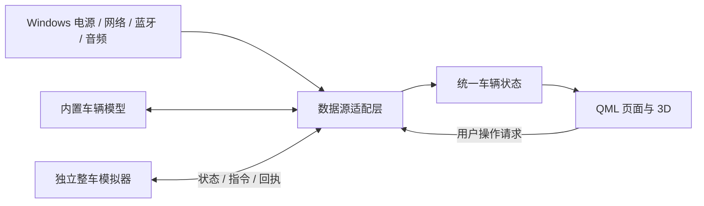

# 整车数据映射与独立模拟器方案 v2

> 实施更新（2026-11-02）：此文保留前期完整评估。后续已按用户决定改为 `qml-cockpit` 与 `qml-cockpit-simulator` 两个平级独立仓库；首阶段已实现外部车辆数据、指令回执及故障联调。当前实现范围与验收记录见 [双进程联调-首阶段验收.md](双进程联调-首阶段验收.md)。下文中的同仓库、Windows 接入、共享模型重构、场景回放等描述不表示已交付。

日期：2026-11-02。依据：用户将电脑作为车辆替身的定位、现有 VehicleState/VehicleSimulation/VehicleMotion 实现及 Windows、Qt 官方接口。本文件是设计评估，尚未实现新数据源或模拟器。

## 一、推荐决策

1. 界面统一使用车辆语义：车辆电量、车辆网络、蓝牙音源。电脑电池可以直接映射为车辆 SOC，不再要求顶部单独显示“电脑电量”。
2. 数据来源放在设置和连接详情中，提供“电脑映射 / 内置演示 / 外部联调”模式标识；正常操作页面仍以车辆为中心。
3. 建议新增独立整车模拟器，与主程序放在同一个仓库、使用同一套 CMake 工程，分别生成两个 EXE。
4. 先建立统一状态/指令接口，再接 Windows 和外部模拟器。日常仍可单独启动主程序，内置演示保持可用。

上一版将电脑电量和车辆电量分别显示，是另一种产品定位。本版按用户最新选择替代该建议；原方案中蓝牙音频、系统网络能力探测等技术结论仍可复用。

## 二、电脑作为整车替身的映射

| 电脑输入 | 车辆界面语义 | 映射规则 |
|---|---|---|
| 系统电池百分比 | 车辆 SOC | 顶栏、首页、行驶页、充电页使用同一个确认值 |
| 有电池设备接入外部电源 | 接电/插枪事件 | 表示已接电，不直接等于正在充电 |
| 系统实际充电标志 | 充电中 | 以系统状态为准，处理接电未充电和满电 |
| 电池供电、百分比下降 | 车辆电量消耗 | 直接反映电脑实际变化，不叠加虚拟行驶扣电 |
| 实际蓝牙能力与音频接收连接 | 车辆蓝牙/手机音源 | 使用真实设备和音频状态 |
| 当前以太网、Wi-Fi、蜂窝连接 | 车辆联网状态 | 显示当前类型；不把普通网线换名为 5G |
| Windows 输出设备 | 车辆扬声器/耳机输出 | 本地与手机接收音频分别按实际输出路径处理 |
| 电脑时钟 | 车辆时间 | 沿用当前实现 |

Windows 的 SYSTEM_POWER_STATUS 提供供电、电池百分比和充电标志，也能区分无电池、状态未知等情况。其剩余电池时间不是车辆续航或充电完成时间。[S1]

### 电量统一后必须一起调整的规则

- 每次会话选定一个能量数据源，只有该来源可以写 SOC。Windows 提供真实 SOC 时，现有 advanceSimulation() 不再增减这个值。
- 电脑映射的电量变化由实际硬件决定。模拟车速 40 km/h 不代表电脑电池会按汽车能耗下降；不能用提高电脑负载的方式制造掉电。
- Windows 基本电源接口没有给出汽车充电功率、60 kWh 电池容量或汽车充电 ETA。这些字段在映射模式应显示“未提供”，或明确标为虚拟车辆模型估算。
- 车辆续航可以按“虚拟车辆容量/能耗 + 当前 SOC”估算，显示估算属性。电脑的 Wh 容量不直接当作车辆 kWh。
- Windows 上报整百分比时按该精度展示；仿真来源可以提供小数精度。
- 普通 Windows 电源接口不承诺可控制实际电池启停充电或充电上限。映射模式的充电控制区主要展示实际状态；模拟启停、目标电量和充电快进在仿真模式生效。
- 有电池设备已映射为插枪时，开始行驶沿用插枪互锁，提示断开电源或选择仿真模式。虚拟行驶中检测到电脑接电时，上报外部供电事件并提示，不静默修改挡位。完整汽车充电/行驶因果由仿真模式验证。

### 台式机与异常情况

- 无电池不代表车辆 SOC 为 0% 或 100%，台式机常供交流电也不代表车辆已插枪。
- 启动时检测到无电池，默认提供内置演示能量来源，并说明“当前车辆电量使用模拟数据”；真实网络和音频仍可使用。
- 已在电脑映射模式运行时，若电量读取失败，保留最后已知值并标记未知/过期，不静默改成模拟值。
- 蓝牙缺失只影响相关连接和收音能力，本地音乐、车辆模拟、网络显示继续工作。

## 三、运行模式与数据所有权

| 模式 | 能量来源 | 车门/车窗/挡位/车速等 | 网络、蓝牙与音频 | 用途 |
|---|---|---|---|---|
| 电脑映射 | Windows 电池与充放电状态 | 可复用内置虚拟车辆模型 | 真实 Windows 服务 | 把笔记本作为整车替身，观察真实设备变化 |
| 内置演示 | 内置虚拟电池模型 | 内置车辆模型 | 默认真实系统服务 | 单程序运行、台式机体验、普通展示 |
| 外部联调 | 独立模拟器 | 独立模拟器 | 默认真实 Windows 服务；连接图标的故障样本可显式另选测试来源 | 双程序联调、脚本场景、拒绝/延迟/断线测试 |

按数据域决定来源，不允许同一个字段由两个提供器同时写入。车辆能量为一组切换，避免 SOC 来自 Windows、充电功率却仍固定取模拟器的 55 kW。

真实蓝牙音频与“蓝牙图标测试状态”分开。模拟器可以注入连接状态检查界面，但不能把模拟连接标记当作实际音频接收成功。真实手机出声仍需 Windows 音频服务和蓝牙硬件。[S2]

切换来源时：停止旧源的模拟推进和未完成命令，增加会话代次，初始化新源快照，再启用操作；旧回执不能改变新源状态。仅保存用户的数据源偏好，不把断线时的旧状态当成下一次启动的真实车辆状态。

## 四、独立模拟器为什么值得做

当前按钮调用 VehicleState 后，状态、演算、完成定时器和 UI 通知都在一个进程中。它适合演示，但还不能完整验证外部车辆数据延迟、指令拒绝或通信断开时的交互。

独立模拟器让数据在另一个进程内产生，主程序通过接口读状态、发指令。这样可以同时看到：模拟器上的实际状态、主程序上的反馈以及两者之间的指令流。

建议项目布局：

```text
qml-cockpit/
  src/                 车机状态门面、数据接入和 UI 桥接
  qml/                 现有车机界面
  shared/              协议类型、虚拟车辆模型
  simulator/           独立模拟器界面与服务入口
  scenarios/           场景脚本、回放样本
  tests/               模型、协议与双进程联调测试

build/CarTerminal.exe
build/VehicleSimulator.exe
```

两个程序复用一套虚拟车辆模型，保持门锁互锁、车窗速度和能耗规则一致。主程序通过内置适配器直接调用该模型，模拟器通过通信接口调用同一模型；避免维护两套演算规则。

模拟器首版采用参数控制台、场景执行器和事件日志。界面可用独立 Qt Widgets target 实现，主车机保留 QML。

## 五、首版模拟器内容

| 区域 | 控件与数据 | 可验证的交互 |
|---|---|---|
| 连接 | 启动/停止服务、客户端状态、心跳、会话标识 | 主程序连接、断开、重连、数据过期 |
| 行驶 | P/R/N/D、速度、累计里程 | 大号挡位/车速、车轮/道路运动、导航推进、驻车停止 |
| 能量 | SOC、插枪、充电状态、功率、目标、时间倍率 | 电量跨页一致、低电量提醒、充电进度/目标到达 |
| 车身 | 四门、四窗、前后备厢、锁车、后视镜、灯光 | 3D 部件位置、局部反馈、通知、互锁 |
| 舒适 | 双区温度、风量、加热等 | 跨页状态与动作反馈 |
| 故障 | 命令延迟、拒绝、不回执、暂停遥测、断线 | 执行中、失败、超时和恢复状态 |
| 记录 | 请求、接收、执行、完成、拒绝及原因 | 从界面操作追踪到实际状态变化 |

模拟器要区分“外部传感器状态注入”和“车机发来的操作指令”。正常场景按车辆规则演算；测试模式允许注入明确标记的异常组合，检验 UI 是否提示问题，而不是由界面偷偷修正数据。

首版场景建议：

1. 正常上车出发：解锁、关门、D 挡、调速、停车、锁车。
2. 四窗通风：目标 15%/50%/100%、连续调整、中途停止和全部关闭。
3. 补能：低电量、连接充电枪、充电、达到目标、拔枪。
4. 操作受限：开门请求行驶、插枪请求行驶、车窗故障拒绝。
5. 通信异常：命令已接收但未完成、数据暂停、进程退出和重连。

## 六、数据与指令的闭环



这里的箭头表示能力关系，实际每个数据域只启用选定来源。VehicleState 保留为 QML 的兼容门面，逐步将其内部演算迁到共享模型，将直接赋值改成“请求 + 确认状态”。

### 状态帧

状态至少包含协议版本、sessionId、序号、时间戳、数据来源、有效性以及车辆数据。核心字段包括 SOC、充电状态、功率、挡位、速度、里程、车门/车窗实际值与目标值、动作状态等。

实际值、目标值、待处理状态分别保留。一个完整快照来自同一模型时间点；部分更新必须带序号和归属域，不能拼接过期数据。

### 指令生命周期

```text
用户要求左前窗到 40%
→ 主程序发送 SetWindowTarget（目标40，requestId）
→ 模拟器回执 Accepted / Rejected（原因）
→ 遥测连续上报当前开度、目标40、正在调整
→ 达到40后回执 Completed，并上报停止状态
→ 主程序显示完成反馈
```

“已接收”不等于“已完成”。主程序可以即时显示输入目标和正在发送，但不能在点击时把确认的实际值直接改成目标。3D 窗位由确认遥测驱动；需要平滑时在相邻数据之间插值。

requestId 与 sessionId 用于回执匹配和去重；重复请求不应重复执行。同一部件的新目标可取代旧目标，并明确旧请求已被替换。重置、断线和来源切换会取消旧请求，旧完成通知不能再出现。

### 传输建议

首版使用 QLocalServer/QLocalSocket，本机双进程通信即可。在 Windows 上 QLocalSocket 使用命名管道。[S3]

协议采用有长度边界的 UTF-8 JSON，限制消息大小、校验协议版本、字段类型、枚举和范围；不能假设一次 read 恰好等于一条消息。后续需要跨电脑联调时，再保留同一消息协议增加 TCP/WebSocket 适配器。

使用本用户访问范围、唯一服务名与单实例锁。服务端异步读写，UI 线程不阻塞等待消息；异常帧被拒绝并记录原因。[S4]

### 频率、时间与断线

- 模型使用统一虚拟时间；推荐行驶与动作演算 20–50 Hz、正常遥测约 10 Hz、UI 渲染独立平滑。数值是初始配置，后续按实测调整。
- 车速、里程、能耗与导航推进共用同一时间和距离来源。路线由导航模块提供，不能在 UI 与模拟器两边分别推进同一路程。
- 心跳建议 1 秒，约 3 秒无数据进入过期状态；命令接收超时与动作完成超时分别定义。
- 断线保留最后值并标记过期，停止依赖新数据的道路/车轮运动并限制控制；不能把断线当作车辆已驻车或电量归零。
- 重连后先交换版本、能力和完整快照，再恢复控制；不自动重放开门、开始充电等旧指令。
- 支持实时、暂停、单步、倍率与重置。Windows 真实电量不受虚拟时间倍率影响。
- 日志采用请求/事件与时间戳记录，逐步增加 JSONL 录制回放；首版回放为只读，避免实时指令与历史状态互相覆盖。

## 七、蓝牙、网络与模拟器的关系

网络状态和真实蓝牙音频是设备服务，不能由整车模拟器代替实际硬件。模拟器主要提供车辆状态以及可控的故障样本。

- 在笔记本上：电脑电池映射车辆 SOC，真实手机音源和 Wi-Fi 可以一起参与演示，车身部件仍是虚拟状态。
- 在无电池、无蓝牙的台式机上：通过内置/外部车辆模型提供 SOC 和车控；使用真实有线网络和本地音乐。
- 在外部联调时：由模拟器接管车辆能量与车身数据，真实蓝牙音频可继续由系统服务提供。若测试蓝牙图标故障，要显式选择测试来源，不能影响或冒充真实接收会话。

配对、音频接收就绪与实际播放分别表示。手机媒体接收可采用 Windows AudioPlaybackConnection；曲名、封面、远端切歌和通话继续按上一版方案分别评估。[S2]

## 八、实施顺序与验收

### 阶段 A：统一数据接口

定义车辆状态、指令、回执、来源和有效性；抽取现有虚拟模型，保留当前页面行为。完成单来源写入、实际/目标分离、取消旧请求、内部模拟 Provider。

验收：当前车窗、3D、行驶、充电和媒体回归继续通过；QML 不需要知道 Windows 或模拟器的具体 API。

### 阶段 B：独立模拟器最小闭环

新增第二个 EXE、本机通信、连接指示与事件日志。优先打通 SOC/充电、挡位/车速/里程、四门四窗，再扩展灯光、舒适和故障脚本。

验收：在模拟器改变窗位，主程序 3D 与百分比一致；主程序请求开窗，模拟器能收到请求并推动实际值；拒绝/超时/断线不会显示成功。

### 阶段 C：Windows 映射

接电池、供电、真实网络和蓝牙状态；调整充电页在映射模式下的能力和文案。无电池设备启用明确的模拟能量来源，状态未知有独立处理。

验收：电脑电池变化同步到所有车辆电量入口；不能同时出现系统电量与模拟电量竞争；台式机常供电不被判作满电或插枪。

### 阶段 D：真实手机音频与场景联调

带硬件验证收音、输出设备、断连恢复；添加能量/车身/通信异常场景、暂停单步与录制回放。

验收：真实声音在电脑输出，音源切换不混播；蓝牙/网络状态与所选来源一致；相同场景可重复运行并定位问题。

推荐先 A+B，再 C，最后 D。独立模拟器能首先解决当前台式开发机缺少电池、蓝牙时的交互验证问题。整个阶段保持调试构建，不生成便携包。

## 官方依据

- [S1 Windows SYSTEM_POWER_STATUS](https://learn.microsoft.com/en-us/windows/win32/api/winbase/ns-winbase-system_power_status)
- [S2 Windows 接收远端蓝牙音频](https://learn.microsoft.com/en-us/windows/apps/develop/media-playback/enable-remote-audio-playback)
- [S3 Qt QLocalSocket](https://doc.qt.io/qt-6/qlocalsocket.html)
- [S4 Qt QLocalServer](https://doc.qt.io/qt-6/qlocalserver.html)

[S1]: https://learn.microsoft.com/en-us/windows/win32/api/winbase/ns-winbase-system_power_status
[S2]: https://learn.microsoft.com/en-us/windows/apps/develop/media-playback/enable-remote-audio-playback
[S3]: https://doc.qt.io/qt-6/qlocalsocket.html
[S4]: https://doc.qt.io/qt-6/qlocalserver.html
